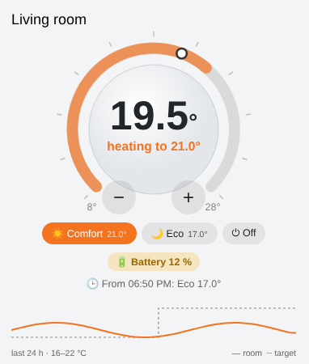

# FRITZ!DECT Thermostat Card

A radiator thermostat as a big dial – made for **AVM FRITZ!DECT** thermostats (301, 302, Comet DECT), and usable with any `climate` entity.



- Room temperature in the middle, target as an arc; the arc pulses while heating.
- **−/+** buttons (0.5 °C steps, debounced), **Comfort / Eco / Off** presets with their temperatures.
- Chips for **window open**, **summer mode**, **holiday mode** and **low battery**.
- **Next scheduled change** (“From 18:00: Eco 17.0°”).
- **24-hour chart** of room and target temperature.
- Several thermostats in one room via `members`.
- English and German texts.

## Installation

**HACS:** HACS → ⋮ → *Custom repositories* → add this repository with type *Dashboard* → install → reload the browser.
**Manual:** copy `fritzdect-thermostat-card.js` to `config/www/` and add `/local/fritzdect-thermostat-card.js` as a JavaScript module resource.

## Options

| Option | Description |
|---|---|
| `entity` | Climate entity (required) |
| `title` | Card title (default: friendly name) |
| `members` | Further climate entities in the same room (temperature, window, battery listed below) |
| `battery_low` | Battery warning threshold in % (default 15) |
| `prefix` | Entity-ID prefix of the extra sensors (default: object ID of `entity`) |
| `sensors` | Explicit sensors if your IDs differ: `battery`, `eco`, `comfort`, `next_time`, `next_temp`, `next_preset`, `window`, `summer`, `holiday` |

The card finds the extra FRITZ!SmartHome sensors automatically in German and English installations (e.g. `sensor.<name>_battery` / `sensor.<name>_batterie`, `binary_sensor.<name>_open_window_detected` / `…_offenes_fenster_erkannt`).

```yaml
type: custom:fritzdect-thermostat-card
entity: climate.living_room
```

```yaml
type: custom:fritzdect-thermostat-card
entity: climate.office
sensors:
  window: binary_sensor.office_window
```

## Deutsch

FRITZ!DECT-Heizkörperregler als Drehknopf: Raum- und Zieltemperatur, Komfort/Eco/Aus, Fenster offen, Sommer- und Urlaubsmodus, Batterie, nächste Zeitplan-Änderung und 24-Stunden-Verlauf. Funktioniert mit deutschen und englischen Entitätsnamen.

## License

MIT – see [LICENSE](LICENSE).
